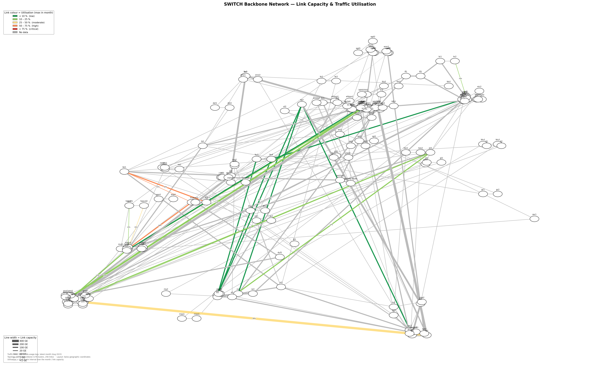
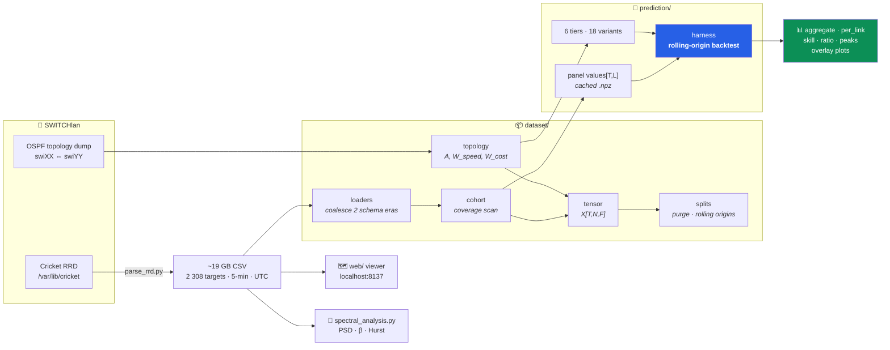

<div align="center">

# 🌱 Green Routing

### Can you forecast a national research backbone well enough to *power parts of it down*?

**An end-to-end lab on real SWITCHlan telemetry** — 5-minute traffic from ~200 routers,
a six-tier forecasting ladder from `y(t+1) = y(t)` to Graph WaveNet, a frequency-domain
study of two and a half years of backbone load, and an interactive map that replays it all.

<p>


</p>



<sub><b>25 backbone routers · 153 access routers · line width = capacity (1 GE → 400 GE) · colour = peak utilisation</b><br>
Generated by <a href="visualize_topology.py"><code>visualize_topology.py</code></a> from the live OSPF topology dump.</sub>

</div>

---

## Why this exists

A backbone burns roughly the same power at 3 a.m. as it does at peak — routers, line cards
and optical shelves are provisioned for the worst case and then left on. The obvious win is to
**consolidate traffic and sleep the spare capacity**. The obvious risk is that you sleep a link
five minutes before it is needed.

So *green routing is a forecasting problem first*. Before any energy-aware optimiser can be
trusted, someone has to answer the boring question honestly:

> **How far ahead can you actually predict a real ISP link — and how much does each extra
> tier of model complexity buy you?**

This repository is that answer, built on the real thing rather than a benchmark dataset: the
Swiss national research and education backbone, at its native 5-minute SNMP resolution.

<table>
<tr><td width="33%" valign="top">

### 🧊 The data problem
1 923 interface series, two incompatible schema eras inside every CSV, ~19 GB, wildly uneven
coverage. `dataset/` turns it into dense tensors you can actually train on.

</td><td width="33%" valign="top">

### 📈 The forecasting problem
12 models across 6 tiers — 18 scored variants once you count the online twins — all held to
**identical rolling origins**. Persistence is the opponent, not the footnote.

</td><td width="33%" valign="top">

### 🔭 The seeing problem
A spectral study of 48 backbone links (1/f slopes, Hurst, diurnal SNR) and a browser viewer
that scrubs 2.5 years of load across the map.

</td></tr>
</table>

---

## 🚀 Quickstart

```bash
git clone git@github.com:qyy2003/Green_Routing.git
cd Green_Routing
```

**Requirements** · Tiers 1–3 need only `pandas numpy scikit-learn statsmodels scipy matplotlib`.
Tiers 4–6 add `torch` (CUDA build recommended — they fall back to CPU, slowly; override with
`PRED_DEVICE=cpu|cuda`). The map viewer and `web/` pipeline are pure standard library; the hero
map needs `networkx` + `matplotlib`.

<details open>
<summary><b>1 · Run the forecasting ladder</b> — baselines vs. GBDT on a small cohort (minutes, CPU)</summary>

```bash
cd code
python -m prediction.run \
    --start 2024-06-01 --end 2024-10-01 \
    --train-end 2024-08-15 --val-start 2024-08-22 \
    --val-end 2024-09-05  --test-start 2024-09-12 \
    --tiers 1 3 --horizons 5min 1h day \
    --max-links 30 --max-origins 60 \
    --out ../artifacts/pred_demo
```

Everything — persistence through Graph WaveNet — lands on the same origins, so the skill
column is an honest number. Add `--tiers 1 2 3 4 5 6` for the full ladder (needs a GPU),
`--online` for test-time-adapted twins, `--resume` to continue an interrupted run.

</details>

<details>
<summary><b>2 · Build a benchmark tensor</b> — cohort selection, node aggregation, leak-free splits</summary>

```bash
cd code
python -m dataset.build \
    --start 2024-01-01 --end 2025-01-01 \
    --train-end 2024-08-31 --val-start 2024-09-08 \
    --val-end 2024-10-20 --test-start 2024-10-27 \
    --min-coverage 0.9 --horizon 288 --lookback 2016 \
    --out ../artifacts/traffic2024
```

Writes `tensor.npz` (`X[T,N,F]`), `adjacency.npz` (`A`, `W_speed`, `W_cost`), `splits.json`
(train/val/test **+ purge gaps + rolling origins + federated partitions**), `cohort.csv`.

</details>

<details>
<summary><b>3 · Launch the interactive backbone viewer</b></summary>

```bash
cd web
python3 build_topology.py    # -> data/links.json, data/node_devices.json
python3 build_frames.py      # -> data/frames/<YYYYMM>.json   (~3 min, reads ~250 CSVs)
python3 server.py            # http://localhost:8137
```

Scrub time, pick a window (5 min → 1 month) and an aggregate (mean/max/min/median), toggle
link utilisation vs. node CPU/power/temperature, hover any link for a live traffic plot,
click to pin it. Views are shareable via URL params.

</details>

> [!IMPORTANT]
> The telemetry itself is **not** in this repo. You need the `network-energy-efficiency-research`
> checkout as a sibling directory and the parsed Cricket export on disk — see
> [Data access](#-data-access). Paths live in [`code/dataset/config.py`](code/dataset/config.py).

---

## 🏗 How it fits together



---

## 🪜 The method ladder

Every tier has to **earn its place** by clearly beating the tier below it on the *same*
chronological split and the *same* metric. Complexity is a cost, not a virtue.

| Tier | Models | Principle | Module |
|:--:|---|---|---|
| **1** | Persistence · Seasonal-naive (day/week) · Historical average | Traffic = strong short-term autocorrelation + hard daily/weekly seasonality. Zero learning. | [`baselines.py`](code/prediction/baselines.py) |
| **2** | Holt–Winters · SARIMA(·)ₛ₌₂₈₈ | Linear models with explicit seasonality, one per link. | [`models_classical.py`](code/prediction/models_classical.py) |
| **3** | Global histogram GBDT | Forecasting as tabular regression: lags + rolling stats + calendar + link id, direct multi-horizon. **The real baseline-to-beat.** | [`models_gbdt.py`](code/prediction/models_gbdt.py) |
| **4** | GRU (2×128) · residual TCN (Bai et al.) | Learn temporal dynamics end-to-end; one global net + per-link embedding. | [`models_deep.py`](code/prediction/models_deep.py) |
| **5** | DLinear (the control) · PatchTST | Long-sequence attention over patch tokens — with a linear model alongside to keep it honest. | [`models_deep.py`](code/prediction/models_deep.py) |
| **6** | Graph WaveNet over the **link-level graph** | Two links sharing a router are physically coupled; fixed + *adaptive* adjacency, order-2 diffusion. | [`models_gnn.py`](code/prediction/models_gnn.py) |

Adding a model is a subclass and one line: implement `predict(ctx)`, register it in
`run.build_models`, and it is automatically held to the same origins and metrics as everything else.

---

## 📊 Results

**Setup** · 50 links · panel 2024-01 → 2025-10 · train ≤ 2025-08-15, val 08-22 → 09-05,
test from 2025-09-12 · 120 rolling origins · lookback 288 · MAE in Mbps.
**Skill = 1 − MAE_model / MAE_persistence** (higher is better; 0 = ties persistence).

```text
best model per horizon — skill vs persistence (MAE)        1 block ≈ 0.02 skill

  5 min   persistence unbeaten  ✗                −0.39   best learned model *
  1 hour  ████████████░░░░░░░░░░░░░░░░░░         +0.239  gbdt + online
  1 day   ██████████████░░░░░░░░░░░░░░░░         +0.279  gbdt
  1 week  ██████░░░░░░░░░░░░░░░░░░░░░░░░         +0.110  gbdt

  * the 5-min number is from an earlier run on a different cohort (code/results.md)
```

| Tier | Model | 1 hour | 1 day | 1 week |
|:--:|---|:--:|:--:|:--:|
| 1 | persistence | `0.000` | `0.000` | `0.000` |
| 1 | seasonal-naive (week) | −0.143 | +0.078 | `0.000` |
| 1 | historical average | +0.015 | +0.190 | +0.084 |
| 2 | Holt–Winters | +0.102 | −0.023 | 💥 |
| 2 | SARIMA *(s = 288)* | 💥 | 💥 | 💥 |
| **3** | **GBDT** | +0.233 | **+0.279** | **+0.110** |
| **3** | **GBDT + online** | **+0.239** | +0.270 | +0.101 |
| 4 | GRU | +0.126 | +0.083 | +0.036 |
| 4 | GRU + online | +0.160 | +0.097 | +0.050 |
| 4 | TCN | +0.090 | +0.098 | +0.020 |
| 5 | DLinear *(linear control)* | +0.068 | +0.073 | +0.037 |
| 5 | PatchTST | +0.095 | +0.104 | −0.012 |
| 5 | PatchTST + online | +0.142 | +0.087 | +0.039 |
| 6 | Graph WaveNet | +0.050 | +0.127 | +0.042 |
| 6 | Graph WaveNet + online | +0.077 | +0.125 | +0.048 |

<sub>💥 = numerically diverged. A true seasonal SARIMA at `s = 288` blows up on 5-minute link
traffic; Holt–Winters follows it at the week horizon. Both are reported rather than hidden —
that instability is the finding.</sub>

**What the table says**

- 🥇 **Gradient boosting wins all three horizons here.** Tiers 4–6 — a GRU, a TCN, a
  paper-config PatchTST, a Graph WaveNet — all cost orders of magnitude more compute and
  *none* of them beat a histogram booster on this cohort. That result is the point, not a bug.
- ⏱ **At 5 minutes, nothing beats persistence.** In an earlier run ([`code/results.md`](code/results.md))
  persistence scores 294 Mbps MAE against GBDT's 410 — a skill of **−0.39**. Learned models
  only start paying rent as the horizon grows.
- 🔁 **Recent data is worth real money.** `+online` variants re-fit on data strictly before each
  forecast origin and gain up to **+5 skill points** (PatchTST at 1 h: +0.095 → +0.142). The
  deeper the model, the more it decays without adaptation.
- 📉 **The horizon curve is brutal.** Best-achievable skill falls from +0.28 at a day to +0.11 at
  a week. For an energy scheduler, that is the number that bounds how far ahead you dare commit.
- 🧭 **Graph structure helps at long range, not short.** Graph WaveNet is the *weakest* learned
  tier at 1 h and the *strongest* at a day — the spatial/reroute signal needs horizon to express
  itself.
- 🤨 **A histogram of past averages beats every deep model at the day horizon.** Historical average
  (+0.190) outranks GRU, TCN, DLinear, PatchTST and the STGNN. If your model can't beat "what
  usually happens at this time on this weekday", it hasn't learned anything.

---

## 🔬 Frequency-domain study

[`code/spectral_analysis.py`](code/spectral_analysis.py) characterises 48 backbone link-pairs
(Jan 2021 → Aug 2023, 5-min) in the frequency domain — Welch PSD, seasonal line spectra,
1/f slope, spectral entropy/flatness, and a spectrogram showing how the diurnal cycle evolved
across the span. Across the 31 links rated *good* quality:

| Metric | Median | Reading |
|---|:--:|---|
| Daily-line SNR | **41.1 dB** | The 24-hour cycle towers over the noise floor — this is why seasonal features are free accuracy. |
| Energy in the daily harmonic | **30.2 %** | Nearly a third of all variance sits in one spectral line. |
| Energy in the weekly harmonic | **6.8 %** | Weekends are a real, separate regime. |
| 1/f slope β | **0.97** | Textbook pink noise → long-range dependence, not white residuals. |
| Hurst exponent | **0.98** | Strongly persistent. Bursts are *not* independent shocks. |

The practical consequence for the forecasting ladder: because β ≈ 1 and H ≈ 1, error does not
average out with longer windows the way an i.i.d. assumption would predict — which is exactly
why persistence stays so hard to beat at short horizons.

`code/build_report.py` assembles the figures into a standalone, theme-aware HTML report.

---

## 🧭 Repository map

```
Green_Routing/
├── code/
│   ├── dataset/                    📦 raw CSV → benchmark artifacts
│   │   ├── config.py               paths · STEP=300s · horizons · PSU scaling
│   │   ├── loaders.py              ⭐ coalesces the two schema eras (dsK ↔ K-th named col)
│   │   ├── topology.py             switch-network-topology.txt → A, W_speed, W_cost
│   │   ├── cohort.py               coverage scan → dense cohort on a shared 5-min grid
│   │   ├── tensor.py               interfaces → device nodes → X[T,N,F]
│   │   ├── splits.py               chronological split + purge · rolling origins ·
│   │   │                           federated partition · inductive node split
│   │   └── build.py                end-to-end CLI
│   │
│   ├── prediction/                 🧠 the method ladder
│   │   ├── data.py                 per-link panel values[T,L], cached to artifacts/
│   │   ├── metrics.py              MAE · RMSE · sMAPE · WAPE · MASE · skill
│   │   ├── harness.py              ⭐ rolling-origin backtest · checkpoints · resume
│   │   ├── baselines.py            tier 1        models_gbdt.py    tier 3
│   │   ├── models_classical.py     tier 2        models_deep.py    tiers 4–5
│   │   ├── models_gnn.py           tier 6        torch_common.py   RevIN · Huber · sched
│   │   ├── calendar_features.py    day-of-week + Swiss holidays as known-future covariates
│   │   ├── run.py                  CLI orchestrator
│   │   └── per-link-traffic-prediction-roadmap.md   📖 the design doc behind all of it
│   │
│   ├── spectral_analysis.py        🔬 PSD · seasonal lines · β · Hurst · spectrogram
│   ├── spectral_figures.py         report figures
│   └── build_report.py             standalone HTML report
│
├── web/                            🗺 interactive backbone viewer (vanilla JS + stdlib, no deps)
│   ├── build_topology.py           topology → 42 drawable PoP links + capacities
│   ├── build_frames.py             CSVs → compact per-month JSON frames
│   ├── server.py                   static site + /api/{meta,frame,agg,series}
│   └── app.js · index.html         pan/zoom map · time scrubber · hover inspector
│
├── visualize_topology.py           🖼 the hero map above (SVG + PNG)
├── web_topology.py                 Dash prototype: 45 backbone pairs, 5-min timeline
├── parse_rrd.py                    RRD → CSV → S3 (runs as a nightly cron at SWITCH)
└── update-topology.sh              nightly OSPF topology re-extraction
```

---

## 🛡 The rules that keep the numbers honest

Most forecasting projects quietly leak the future. These are the guardrails built into the harness:

- **One split, one set of origins.** Every model — naive through STGNN — is scored at the same
  origins on the same targets. Cross-model comparisons are apples to apples by construction.
- **A model may only see data `< origin`.** Global models fit once on train; `+online` variants
  may fine-tune, but only on anchors whose *entire target path* ends before the origin
  (`anchor + max_horizon ≤ o − 1`). The harness enforces the cadence; the model enforces the cutoff.
- **Purge gaps between blocks**, sized `lookback + horizon`, so no training window can straddle a
  boundary.
- **Metrics in original scale (Mbps), always.** Models own their own `log1p`/RevIN transforms and
  invert before scoring. MAPE is banned — it explodes on idle links; sMAPE/WAPE/MASE instead.
- **Skill vs. persistence and seasonal-naive is the headline**, never raw error.
- **Model selection on a chronological val block**, at the scored horizons only — with 1/√h
  weighting, two TCNs whose day-horizon MAE differed by 13 % looked identical.
- **Plot, don't just tabulate.** `overlay_forecasts.png` shows busy / bursty / quiet links so you
  can catch the classic failure: a model that has merely learned to output the last value, one
  step late.
- **Seeded per model name**, so results are bit-reproducible and independent of training order.
- **Ctrl-C is safe.** Weights checkpoint after training, predictions flush per model, `--resume`
  picks up where you stopped.

---

## 💾 Data access

| Piece | Where | Size |
|---|---|---|
| Parsed Cricket time-series | on-disk export (`SWITCH_ROOT`, default `~/switch`) | ~19 GB, 1 923 interface series / 208 devices |
| Topology, inventory, environment, backbone logs | `network-energy-efficiency-research/` sibling repo | — |
| Upstream archive | SWITCHengines object storage (`switchlan-load-timeseries`) | daily since 2023-12-31 |

**Coverage in practice:** over a 2025-12 → 2026-07 window, **886 of 1 923 links on 141 devices**
clear a 0.9 coverage threshold (830 clear 0.99). Adding a 1 Mbps mean-traffic floor to drop idle
ports leaves **547 links** — the cohort worth benchmarking on. The router-level topology has
**395 router-pair links over 85 nodes**; the map viewer draws **42 PoP-to-PoP links**.

Without the sibling repo, [`dataset/build_topology_txt.py`](code/dataset/build_topology_txt.py)
reconstructs a device-level topology from the JSON that *is* checked in here — enough for the
STGNN's adjacency.

---

## 🗺 Roadmap

- [x] Two-era CSV coalescing, coverage-driven cohort selection, leak-free splits
- [x] Six-tier forecasting ladder on identical rolling origins
- [x] Online / test-time adaptation with a hard leakage guarantee
- [x] Peak-aware training (`--under-weight`) — every learned tier under-predicts the top decile
- [x] Frequency-domain characterisation of the backbone
- [x] Interactive time-travelling map viewer
- [ ] **Energy model** — PSU and ECI shelf power are already loaded; turn watts into an objective
- [ ] **The actual green routing** — sleep-scheduling links under a forecast-uncertainty budget
- [ ] **Privacy** — how much can an operator blur real volumes and still schedule well?
      ([`idea.md`](idea.md))
- [ ] Foundation models (TimesFM / Chronos) zero-shot; diffusion forecasts scored by CRPS

The unchecked boxes are the open research questions this infrastructure was built to attack. There
is a trade-off between accuracy and how much data you collect, process, and are willing to expose —
and the shorter the horizon, the better the accuracy. Finding where that curve crosses "safe to
power down a line card" is the goal.

---

## 📚 Further reading in this repo

| Document | What it covers |
|---|---|
| [`code/prediction/per-link-traffic-prediction-roadmap.md`](code/prediction/per-link-traffic-prediction-roadmap.md) | The full design doc: every tier, its principle, its limits, and the evaluation traps |
| [`code/prediction/README.md`](code/prediction/README.md) | Harness internals, model sizes, online adaptation, checkpointing, every CLI flag |
| [`code/dataset/README.md`](code/dataset/README.md) | Schema eras, coverage, artifact formats, downstream loading |
| [`web/README.md`](web/README.md) | Viewer pipeline, API endpoints, coverage caveats |

---

## 🙏 Acknowledgements

Built on telemetry and topology from **[SWITCH](https://www.switch.ch/)**, the Swiss national
research and education network. The nightly topology extraction (`update-topology.sh`) is by
Simon Leinen (SWITCH). Research conducted at **NetSec Group, ETH Zürich**.

<div align="center">
<br>
<sub>If this saved you from re-deriving why persistence keeps winning — ⭐ the repo.</sub>
</div>
