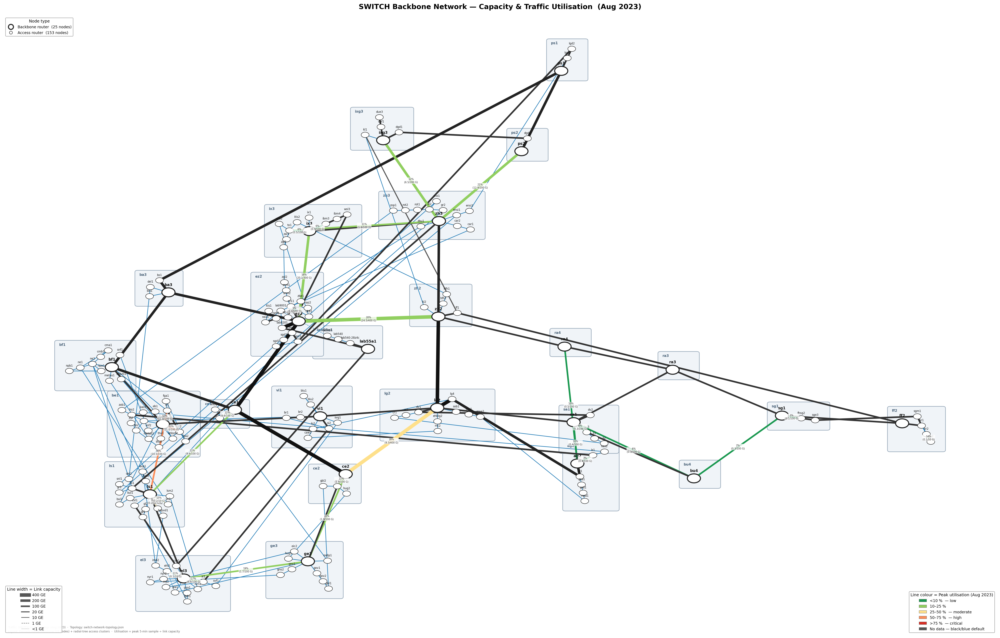

<div align="center">

# 🌱 Green Routing

### How well can you forecast every link of a national research backbone — well enough to bill its carbon and route around dirty power?

Per-link traffic forecasting on real **SWITCHlan** telemetry: 5-minute SNMP data from
~200 routers, a ladder of models from `y(t+h) = y(t)` to transformers and graph networks,
all scored on identical rolling origins, plus viewers that replay it link by link.

<p>


</p>



<sub>25 backbone routers · 153 access routers · line width = capacity (1 GE → 400 GE) · colour = peak utilisation</sub>

</div>

---

## Why

A backbone burns about the same power at 3 a.m. as at peak, and a fair carbon bill per
user needs to know each link's volume before it happens. Both reduce to one modelling
problem: **forecast the traffic on every link, hours to a week ahead** — honestly, against
the baselines that are hard to beat on real ISP data.

On the year-scale benchmark (534 links, one year of 5-minute data, a 111-day test period),
one global model per tier cuts the typical link's error against "repeat the last value" by
**~20 % at 1 hour, ~50 % at 8 hours, ~25 % at 1 day and ~15 % at 1 week**
([results](docs/results.md)).

## What you can do with it

| | Command | Docs |
|---|---|---|
| Read the SWITCH telemetry straight from S3 (cached, both CSV schema eras coalesced) | `gr-data check` · `green_routing.dataset` | [data.md](docs/data.md) |
| Train and backtest the model ladder on identical origins | `gr-benchmark …` | [forecasting.md](docs/forecasting.md) |
| Log every model's forecast at every 5-minute step and score it | `gr-dense predict / verify / metrics` | [forecasting.md](docs/forecasting.md#dense-prediction-logs-gr-dense) |
| Browse forecasts vs. traffic, link by link, with a leaderboard | `gr-viewer` | [viewers.md](docs/viewers.md) |
| Replay traffic and router telemetry on the backbone map | `web/` | [viewers.md](docs/viewers.md#topology-viewer-web) |
| Reproduce the published results and cross-check a new machine | `recipes/year/run.sh all` | [reproduce.md](docs/reproduce.md) |
| Keep good models with their provenance | `gr-zoo add / pack` | [forecasting.md](docs/forecasting.md#model-zoo-gr-zoo) |
| Build tensors + graph + splits for your own models | `gr-build-tensor` | [data.md](docs/data.md#node-tensors-for-other-models-gr-build-tensor) |

## Quickstart

```bash
git clone git@github.com:qyy2003/Green_Routing.git && cd Green_Routing
conda env create -f environment.yml && conda activate green
pip install torch --index-url https://download.pytorch.org/whl/cu130   # match your driver
pip install -e ".[dev]"
pytest -m e2e                                    # whole pipeline on synthetic data, ~5 min
```

Add SWITCHengines S3 credentials to `~/.aws/credentials` ([setup.md](docs/setup.md#3-access-to-the-data-switchengines-s3)), then:

```bash
gr-data check                                    # credentials, bucket, a few CSVs
gr-data warm                                     # download the interface CSVs once (~20 GB)
gr-benchmark --start 2026-01-01 --end 2026-04-01 \
    --train-end 2026-02-20 --val-start 2026-02-27 --val-end 2026-03-06 \
    --test-start 2026-03-13 --tiers 1 3 --horizons 1h 8h day \
    --max-links 30 --max-origins 60 --out artifacts/demo
gr-viewer artifacts/demo                         # http://localhost:8138
```

The full year benchmark: `recipes/year/run.sh all` (~4.5 h on an L40S) —
[reproduce.md](docs/reproduce.md).

## The model ladder

Every tier has to beat the tier below on the same split, origins and metric; complexity is
a cost.

| Tier | Models | Idea |
|:--:|---|---|
| 1 | persistence · seasonal-naive (day, week) · historical average | traffic = short-term memory + daily/weekly cycle; zero learning |
| 2 | Holt–Winters · SARIMA | explicit seasonality per link |
| 3 | global GBDT | forecasting as tabular regression: lags, rolling stats, calendar |
| 4 | GRU · TCN | temporal dynamics end to end, one global net + link embedding |
| 5 | DLinear (control) · PatchTST | attention over patches, with a linear model to keep it honest |
| 6 | Graph WaveNet | diffusion over the router graph + learned adjacency |

All neural models are global (one network for every link), work in log space with
per-window normalisation (a 100 Gbit/s core port and a 1 Mbit/s access port share one
model), and emit the whole 5-minute path in one pass.

## Results

Per-link median MAE ratio vs persistence on the year benchmark (lower is better;
1.000 = no better than repeating the last value):

| Horizon | Report (laptop, 2026-07) | Reproduction, 160 sampled origins | Every 5-min origin |
|---|---|---|---|
| 1 h | 0.801 | 0.787 | 0.780 |
| 8 h | 0.545 | 0.538 | 0.489 |
| 1 day | 0.743 | 0.748 | 0.751 |
| 1 week | 0.842 | 0.849 | 0.859 |

Follow-up experiments ([report](docs/reports/month-window-smoothing.html)): a **30-day
input window** improves 1-day and 1-week forecasts by 2.6–4.7 % for four of five models
but not short horizons; **smoothing the forecast path** by up to an hour is nearly free
at 8 h and longer, while retraining on smoothed targets costs 1.5–8 %. Details, full
tables and caveats: [docs/results.md](docs/results.md).

## Honest-evaluation rules built into the harness

- **One split, one set of origins** for every model; a model sees only data before the origin.
- **Metrics in Mbit/s**, models own their transforms; **per-link ratios vs persistence**
  lead, because pooled errors are a vote of the busiest links.
- **Model selection on a later, chronological validation block**, at the scored horizons.
- **Seeds per model name**, so results don't depend on training order.
- **Every forecast logged** (`gr-dense`): the sampled origins of a backtest can hide
  biases (the year run's fall at only four times of day).
- **Resumable everything**: checkpoints per epoch, records per model, `--resume`.

## Repository map

```text
Green_Routing/
├── src/green_routing/
│   ├── dataset/        S3/local data access, era coalescing, cohorts, tensors, splits
│   ├── prediction/     models, harness, dense logs, metrics, zoo, the gr-benchmark CLI
│   ├── viewer/         gr-viewer (server + static page)
│   └── analysis/       frequency-domain study of backbone traffic
├── recipes/            reproduce the year benchmark and the experiments (+ verify)
├── web/                topology viewer (backbone map over time)
├── tests/              unit + end-to-end smoke tests (synthetic data) + live S3 check
├── docs/               setup · data · forecasting · reproduce · viewers · results ·
│                       roadmap · reports/ (the two HTML reports)
├── tools/              topology map scripts, reference copies of SWITCH's jobs
├── AGENTS.md           knowledge base for picking the work up (people and agents)
├── environment.yml     the conda environment (pinned)
└── pyproject.toml      the package and its command-line tools
```

## Documentation

| | |
|---|---|
| [docs/setup.md](docs/setup.md) | machine, conda environment, PyTorch, S3 credentials, troubleshooting |
| [docs/data.md](docs/data.md) | the bucket, the CSV format, the dataset package, panels |
| [docs/forecasting.md](docs/forecasting.md) | models, training, harness, `gr-benchmark` options, metrics, dense logs, zoo |
| [docs/reproduce.md](docs/reproduce.md) | the recipes, timings, verifying a new machine |
| [docs/viewers.md](docs/viewers.md) | prediction viewer and topology viewer |
| [docs/results.md](docs/results.md) | all current results |
| [docs/roadmap.md](docs/roadmap.md) | the design behind the model ladder and the evaluation |
| [AGENTS.md](AGENTS.md) | state of the project, decisions, pitfalls, next steps |

## Acknowledgements

Built on telemetry and topology from **[SWITCH](https://www.switch.ch/)**, the Swiss
national research and education network. The nightly topology extraction
(`tools/upstream/update-topology.sh`) is by Simon Leinen (SWITCH). Research conducted at
the **NetSec Group, ETH Zürich**.
